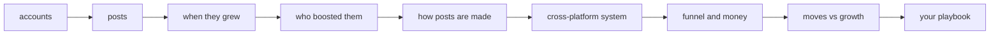
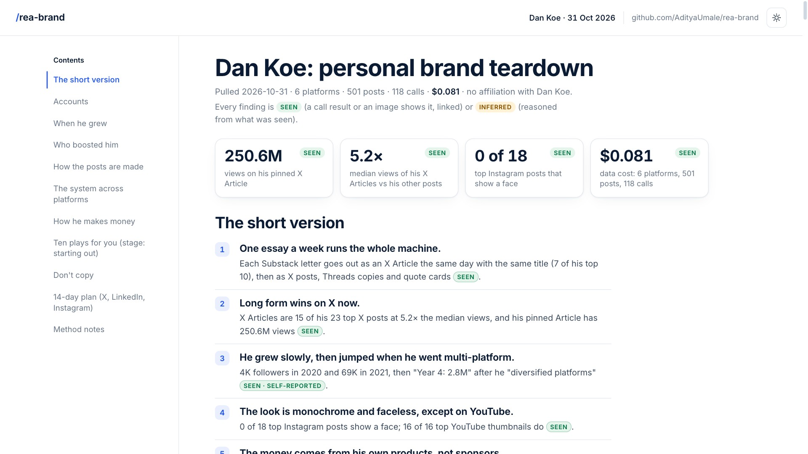

<div align="center">

# /rea-brand

**Reverse engineer anyone's personal brand.**

Name a creator. Get every move behind their growth on X, LinkedIn, Instagram, YouTube, Threads,
Substack and more, plus a playbook you can copy, with a ready prompt for each play.

[](https://docs.claude.com/en/docs/claude-code)
[](https://treg.to)
[](#what-it-costs)
[](LICENSE)

[Install](#install) · [Quick start](#quick-start) · [What you get](#what-you-get) · [Example: Dan Koe](#example-dan-koe) · [Cost](#what-it-costs) · [Rules](#the-rules)

</div>

---

## What it does

You give Claude Code a person: a name, a handle or a profile URL. `/rea-brand` then:

1. **Finds every account they have.** It reads their bio links, link-in-bio page and website.
   Platforms they're not on are skipped and cost nothing. It stops so you can confirm it's the
   right person before spending more.
2. **Pulls their posts.** The latest 100 posts or 12 months on each platform, with views, likes,
   comments and formats.
3. **Finds when they grew.** It builds the curve from their own milestone posts ("we hit 10k"),
   Wayback Machine snapshots and engagement trends, and samples what they posted while still small.
4. **Finds who boosted them.** Big accounts that shared them, podcast guest spots, their reply
   habits and engagement groups.
5. **Shows how the posts are made.** It ranks every post, then looks at the top and bottom
   thumbnails, covers and cards to count what the winners share: formats, hooks, titles, colours,
   faces, topics and voice. Then it writes the fill-in-the-blank formulas.
6. **Maps the system.** How one idea moves across platforms, posting cadence, and the funnel from
   followers to newsletter, products and sponsors, with prices.
7. **Writes your playbook.** Ten plays ranked by evidence and fit for your stage, each with a
   paste-ready prompt, a "don't copy" list, and a 14-day plan.

Every finding is marked **SEEN** (a data point or image shows it, linked) or **INFERRED** (reasoned
from what was seen).



## Install

You need [Claude Code](https://docs.claude.com/en/docs/claude-code) and
[treg](https://treg.to), which supplies the platform data. New treg accounts get $1 of free
credit, enough for about 10 teardowns.

**1. Install and sign in to treg**

```bash
curl -fsSL https://treg.to/install.sh | sh
treg login
```

If the installer says your Python is too new, install [uv](https://docs.astral.sh/uv/) first
(`curl -LsSf https://astral.sh/uv/install.sh | sh`), open a new terminal, and run it again.

**2. Install the skill** (pick one)

One line (macOS / Linux):

```bash
curl -fsSL https://raw.githubusercontent.com/AdityaUmale/rea-brand/main/install.sh | sh
```

Piping a script into a shell runs it straight away. To check it first, read
[`install.sh`](install.sh).

Claude Code plugin marketplace:

```
/plugin marketplace add AdityaUmale/rea-brand
/plugin install rea-brand@rea-brand
```

Manual:

```bash
git clone https://github.com/AdityaUmale/rea-brand
mkdir -p ~/.claude/skills && cp -R rea-brand/skills/rea-brand ~/.claude/skills/
```

Restart Claude Code after installing.

## Quick start

Open Claude Code in an empty folder and type:

```
/rea-brand how did Dan Koe grow? I'm @yourhandle, niche is ___, I'm starting out. Budget 50 cents.
```

Or just ask *"reverse engineer @levelsio's personal brand"* or *"what makes Ali Abdaal's YouTube
titles work?"*. The skill triggers on its own.

For content patterns only, with no growth analysis:

```
/rea-brand content teardown of Justin Welsh, LinkedIn and X only
```

More in [examples/prompts.md](examples/prompts.md).

## What you get



Everything lands in `rea-brand/<person>/`:

| File | What's in it |
|---|---|
| `brand.html` | One-file report built by the skill's template: the five findings on the first screen, stat tiles that link to their evidence, SEEN / INFERRED labels on every claim, contact sheets of top vs bottom posts with linked engagement, a growth chart, a "Copy the prompt" button on every play, light and dark |
| `brand.md` | The same report as Markdown |
| `<platform>/posts.csv` | Every post pulled, in one format across platforms |
| `<platform>/img/` | Top and bottom thumbnails, covers and cards |
| `moves-vs-growth.csv` | Every dated move: launches, viral posts, guest spots, new formats |
| `repurposing.csv` | Posts that carry the same idea across platforms, and which came first |
| `ledger.txt` | Every data call and what it cost |

## Platforms

| Platform | Depth |
|---|---|
| X, LinkedIn, Instagram, YouTube | **Core four:** named data sources and tuned checklists |
| Threads, Substack, TikTok, Facebook, Reddit, Bluesky, Medium, Pinterest | Same steps; the data source is found in treg's catalog while it runs |
| Anything treg has no data for | Listed as skipped, costs nothing |

## Example: Dan Koe

A real run on 2026-10-31: 6 platforms, 501 posts, 118 calls, **8¢**. Full report:
[examples/dan-koe.md](examples/dan-koe.md).

- **One essay a week runs everything.** Each Substack letter goes out as an X Article the same day
  with the same title (7 of his top 10 Articles). 12 of his 15 Threads posts are copied from X, and
  the same quote images go to Instagram and LinkedIn.
- **X Articles win.** 15 of his 23 top X posts are Articles, with a median of 2.0M views against
  384K for his other posts. His pinned Article has 250.6M views.
- **Slow, then fast.** 4K followers in 2020, 69K in 2021, then "doubled down and diversified
  platforms" to 2.8M by 2023, by his own count.
- **Faceless, except on YouTube.** 0 of his 18 top Instagram posts show his face; 16 of 16 top
  YouTube thumbnails do.
- **His own products, no sponsors.** Courses at $99–$299, a $499 bundle, and his app Eden. 0 of
  10 YouTube videos checked carry a sponsor.

## What it costs

Measured on the Dan Koe run (6 platforms):

| Step | Calls | Cost |
|---|---:|---:|
| 1 · find the accounts | 8 | $0.005 |
| 2 · pull the posts | 25 | $0.021 |
| 3 · when they grew | 11 | $0.006 |
| 4 · who boosted them | 34 | $0.017 |
| 5 · how the posts are made | 25 | $0.020 |
| 7 · funnel and money | 15 | $0.012 |
| **Total** | **118** | **$0.081** |

You set a budget cap (default 1 USD). The skill quotes each endpoint's price before its first
call, keeps a running total, and stops before the cap.

## The rules

The skill studies a **public brand**, not a person's private life:

- ✅ Public creators only: an account with 1,000+ followers, or a public figure
- ✅ Public posts, public pages, public archives
- ✅ Only the person and accounts with 10K+ followers are named in the report
- ❌ No logins, cookies, DMs or contact with anyone
- ❌ No follower lists, contact details, location, family or private life
- ❌ No guessing: anything not seen is reported as "not seen"

## Repo layout

```
skills/rea-brand/SKILL.md                 the skill
skills/rea-brand/report/build_report.py   the report template (brand.md → brand.html)
DESIGN.md, PRODUCT.md                     the report's design system and product notes
examples/dan-koe.md                       a full real report
examples/prompts.md          copy-paste prompts
install.sh                   one-line installer
.claude-plugin/              plugin + marketplace manifests
```

## FAQ

**Do I need an X API key or cookies?** No. treg holds the data provider accounts and bills a
fraction of a cent per call. You never paste a key.

**Can it run for free?** Not quite: X and LinkedIn have no free public data. A full teardown costs
about 8¢, and treg's $1 of free credit covers about 10.

**Does it work outside Claude Code?** `SKILL.md` follows the Agent Skills format, so any agent that
reads skills and can run shell commands can use it.

**How accurate is it?** Every number comes from code output on the pulled data and is dated.
Self-reported numbers (a creator's own income or follower claims) are labeled. Causes are always
INFERRED, never stated as fact.

**Can I run it on myself?** Yes, as long as your accounts are public.

## Credits

Inspired by [`/rea-growth`](https://github.com/superdesigndev/treg) from Superdesign, which
reverse engineers a company's growth. `/rea-brand` does the same for a person.

## Contributing

Issues and pull requests are welcome. See [CONTRIBUTING.md](CONTRIBUTING.md). Release notes are in
[CHANGELOG.md](CHANGELOG.md).

## License

[MIT](LICENSE) © 2026 Aditya Umale

---

<div align="center">

Made by [Aditya Umale](https://github.com/AdityaUmale). If it helped you grow, ⭐ the repo.

</div>
